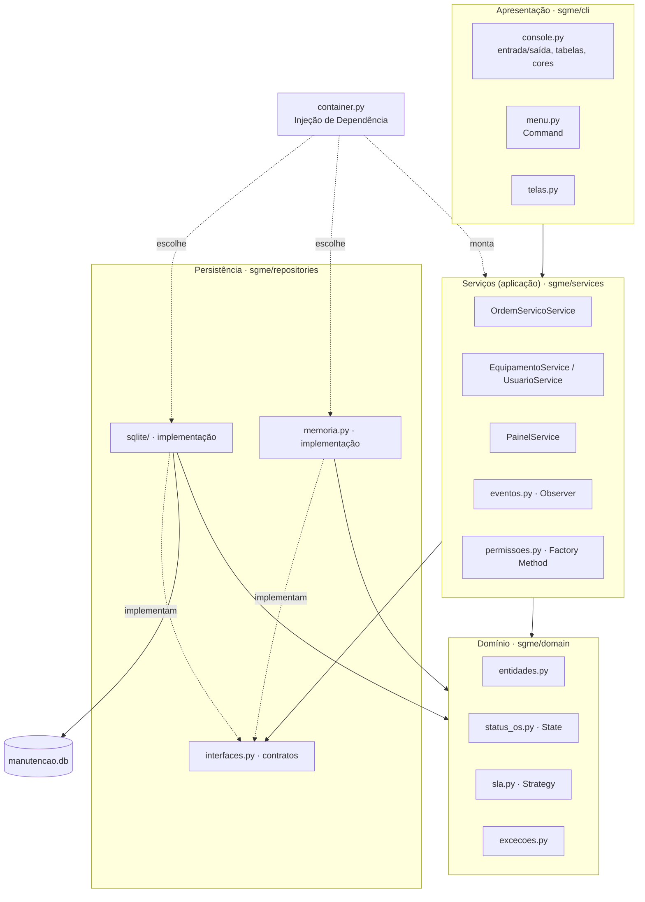
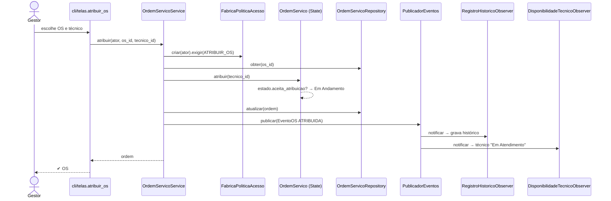
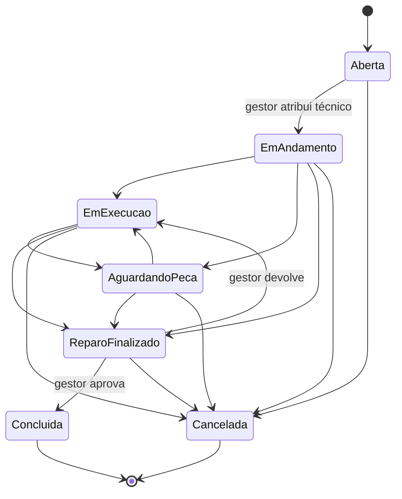

# Relatório Técnico — Entrega 2

**Projeto:** SGME, Sistema de Gestão de Manutenção de Equipamentos
**Tecnologias:** Python 3.12 · SQLite · pytest
**Interface:** aplicação de linha de comando (CLI)

---

## 1. Visão geral

A Entrega 1 era um único arquivo (`legacy/sgme_entrega1.py`, cerca de 280 linhas) em que cada função
misturava três responsabilidades: ler dados com `input()`, executar SQL e imprimir o resultado com
`print()`. Funcionava, mas tinha problemas concretos:

| # | Problema na Entrega 1 | Consequência |
|---|---|---|
| 1 | SQL, regra de negócio e interface na mesma função | Nada podia ser testado ou reaproveitado isoladamente |
| 2 | Dados trafegando como tuplas (`os_data[6]`, `usuario[1]`) | Mudar uma coluna quebrava o código em vários lugares |
| 3 | Status da OS como texto livre | Era possível concluir uma OS nunca atribuída ou alterar uma OS já encerrada |
| 4 | Nenhuma validação de entrada | `float("abc")` ou um ID inexistente derrubava o programa; `encerramento_administrativo` lançava `TypeError` para OS inexistente |
| 5 | Histórico registrado mesmo quando o `UPDATE` não afetava nenhuma linha | O histórico podia registrar ações que não aconteceram |
| 6 | Técnico liberado ao encerrar qualquer OS | Ficava "Disponível" mesmo com outras OS em andamento |
| 7 | Permissões implícitas (apenas qual menu era mostrado) | As funções não verificavam o perfil de quem as chamava |
| 8 | `menu_gestor` e `menu_tecnico` duplicados, com cadeias de `if/elif` | Toda nova opção exigia editar dois lugares e renumerar à mão |
| 9 | "Minhas Ordens de Serviço" do técnico listava todas as OS | Funcionalidade não fazia o que o rótulo prometia |
| 10 | Apontamento de peças sobrescrevia o anterior | Perda de informação a cada apontamento |
| 11 | Criticidade digitada livremente ("Media", "alta", "urgente") | Dados inconsistentes no banco |

A Entrega 2 reorganiza o sistema em camadas e corrige todos esses pontos. As funcionalidades
originais foram mantidas e outras foram acrescentadas (seção 4).

---

## 2. Arquitetura utilizada: arquitetura em camadas (N-Layer)

### 2.1 Descrição

O sistema foi dividido em quatro camadas com dependência em sentido único: cada camada só conhece
as camadas abaixo dela. O domínio não depende de nenhuma outra.



| Camada | Pacote | Responsabilidade | Não pode |
|---|---|---|---|
| Apresentação | `sgme/cli` | Ler o que o usuário digita, chamar serviços e formatar a saída | Acessar o banco ou decidir regras |
| Serviços | `sgme/services` | Orquestrar casos de uso: verificar permissão, carregar, alterar, salvar e publicar eventos | Fazer `print`/`input` ou escrever SQL |
| Domínio | `sgme/domain` | Entidades e regras puras (transições de status, validações, SLA) | Depender de banco, terminal ou bibliotecas externas |
| Persistência | `sgme/repositories` | Traduzir entidades para tabelas SQLite e vice-versa | Conter regras de negócio |

### 2.2 Justificativa da escolha

- **Aderência ao problema.** O sistema é CRUD com regras de negócio (ciclo de vida da OS, permissões
  por perfil e SLA), executado por um único processo. Camadas resolvem exatamente o problema número 1
  da tabela acima, sem a complexidade operacional de microsserviços ou de um microkernel.
- **Testabilidade.** Como os serviços não fazem E/S, os 102 testes chamam os casos de uso diretamente,
  com relógio falso e repositórios em memória.
- **Substituição de tecnologia.** A interface pode virar Web ou API, e o SQLite pode virar PostgreSQL,
  trocando apenas a camada correspondente. Os testes da CLI e dos serviços já usam implementações
  diferentes de entrada/saída e de persistência, o que comprova esse isolamento.
- **Evolução gradual.** O esquema do banco da Entrega 1 foi preservado, com migração automática
  (`Database.inicializar`). A mudança de arquitetura não exigiu descartar dados existentes.

### 2.3 Evidências no código

- Nenhum arquivo fora de `sgme/repositories/sqlite/` importa `sqlite3`.
- Nenhum arquivo fora de `sgme/cli/` usa `input()` ou `print()`.
- `sgme/domain/` não importa nada de `services`, `repositories` ou `cli`.
- `sgme/container.py` é o único módulo que referencia classes concretas de repositório.

Para conferir (PowerShell):

```powershell
Get-ChildItem sgme -Recurse -Filter *.py | Select-String "import sqlite3" | Select-Object Path -Unique
Get-ChildItem sgme -Recurse -Filter *.py | Select-String "\binput\(|\bprint\(" | Select-Object Path -Unique
```

### 2.4 Fluxo de uma requisição

Exemplo: o gestor atribui uma OS a um técnico.



---

## 3. Princípios SOLID e padrões de projeto

### 3.1 SOLID

#### S: Responsabilidade Única

Cada classe tem um único motivo para mudar:

| Classe | Única responsabilidade |
|---|---|
| `Database` (`repositories/sqlite/database.py`) | Abrir conexões e manter o esquema |
| `OrdemServicoRepositorySQLite` | Converter `OrdemServico` ⇄ tabela `ordens_servico` |
| `OrdemServico` (`domain/entidades.py`) | Garantir as invariantes da OS |
| `OrdemServicoService` | Orquestrar os casos de uso da OS |
| `RegistroHistoricoObserver` | Gravar histórico |
| `Console` (`cli/console.py`) | Entrada e saída no terminal |

Compare com a Entrega 1, em que `apontamento_reparos` lia dados, convertia tipos, executava SQL,
registrava histórico e imprimia mensagens.

#### O: Aberto/Fechado

O sistema é estendido acrescentando classes, sem editar as existentes:

- **Novo status de OS:** nova subclasse de `EstadoOS` registrada em `_ESTADOS`.
- **Nova criticidade/SLA:** nova subclasse de `PoliticaSLA`.
- **Nova reação a eventos** (e-mail, auditoria): novo `ObservadorOS` inscrito no container. O teste
  `TestObserverExtensivel` faz exatamente isso sem alterar o serviço.
- **Nova opção de menu:** nova entrada em `COMANDOS`. O laço do `Menu` não muda.

#### L: Substituição de Liskov

`UsuarioRepositoryMemoria` e `UsuarioRepositorySQLite` (e os demais pares) podem substituir um ao
outro em qualquer serviço. A prova é a fixture `container` em `tests/conftest.py`: ela é
parametrizada e executa **todos** os testes de serviço duas vezes, uma com cada implementação,
com o mesmo resultado esperado.

```python
@pytest.fixture(params=["memoria", "sqlite"])
def container(request, tmp_path, relogio):
    repos = (repositorios_memoria() if request.param == "memoria"
             else repositorios_sqlite(str(tmp_path / "teste.db")))
    return montar(repos, relogio)
```

#### I: Segregação de Interfaces

Em vez de uma classe "Banco" com todos os métodos, existem quatro contratos pequenos em
`repositories/interfaces.py`. Cada consumidor depende somente do que usa:

- `RegistroHistoricoObserver` recebe apenas `HistoricoRepository`.
- `DisponibilidadeTecnicoObserver` recebe `UsuarioRepository` e `OrdemServicoRepository`.
- `UsuarioService` recebe apenas `UsuarioRepository`.

#### D: Inversão de Dependência

Os serviços dependem de abstrações recebidas pelo construtor e nunca instanciam dependências:

```python
class OrdemServicoService:
    def __init__(self, ordens: OrdemServicoRepository, equipamentos: EquipamentoRepository,
                 usuarios: UsuarioRepository, historico: HistoricoRepository,
                 eventos: PublicadorEventos, relogio: Relogio = datetime.now) -> None:
```

Até o relógio é injetado, o que permite testar atrasos de SLA "avançando o tempo" nos testes e
criar uma OS atrasada nos dados de demonstração (`seed.py`).

### 3.2 Padrões de projeto

#### Repository (persistência)

- **Onde:** `sgme/repositories/interfaces.py` (contratos), `sqlite/repositorios.py` e `memoria.py` (implementações).
- **Problema que resolve:** na Entrega 1 o SQL estava espalhado por 13 funções e os dados eram tuplas.
  O repositório isola todo o SQL em um lugar e devolve entidades do domínio. É o que cumpre o
  requisito de "persistência integrada de forma desacoplada da regra de negócio".

```python
class OrdemServicoRepository(ABC):
    @abstractmethod
    def obter(self, os_id: int) -> OrdemServico | None: ...
    @abstractmethod
    def listar(self, filtro: FiltroOS | None = None) -> list[OrdemServico]: ...
    @abstractmethod
    def adicionar(self, ordem: OrdemServico) -> OrdemServico: ...
    @abstractmethod
    def atualizar(self, ordem: OrdemServico) -> None: ...
```

#### State (ciclo de vida da OS)

- **Onde:** `sgme/domain/status_os.py`, usado por `OrdemServico`.
- **Problema que resolve:** na Entrega 1 qualquer status podia ser gravado a qualquer momento.
  Agora cada status é um objeto que declara para onde pode ir e o que aceita.



```python
class AguardandoPeca(EstadoOS):
    status = StatusOS.AGUARDANDO_PECA
    transicoes = frozenset({StatusOS.EM_EXECUCAO, StatusOS.REPARO_FINALIZADO, StatusOS.CANCELADA})
    aceita_trabalho_tecnico = True
    aceita_atribuicao = True
```

A CLI também consulta o estado para mostrar apenas os status permitidos e a linha "Próximos status"
nos detalhes da OS.

#### Strategy (SLA por criticidade)

- **Onde:** `sgme/domain/sla.py`.
- **Problema que resolve:** prazo de atendimento e prioridade variam conforme a criticidade.
  Em vez de `if criticidade == 'Alta' … elif …` em vários lugares, cada criticidade tem sua
  estratégia (`SLAAlta` 4 h, `SLAMedia` 24 h, `SLABaixa` 72 h) com `prazo_limite`, `esta_atrasada` e `peso`.
- **Uso:** a fila priorizada do gestor (`OrdemServicoService.fila_priorizada`) ordena por atraso,
  depois pelo `peso` da estratégia e depois pela antiguidade. O painel conta as OS atrasadas.

#### Observer (histórico e disponibilidade)

- **Onde:** `sgme/services/eventos.py`.
- **Problema que resolve:** os problemas 5 e 6 da tabela inicial. O serviço publica um `EventoOS`
  **depois** de salvar com sucesso. Os observadores reagem:
  - `RegistroHistoricoObserver` grava o histórico;
  - `DisponibilidadeTecnicoObserver` recalcula o status do técnico com base nas OS **ativas**
    dele, corrigindo o bug de liberar um técnico que ainda tem trabalho.

#### Factory Method (políticas de acesso por perfil)

- **Onde:** `sgme/services/permissoes.py`.
- **Problema que resolve:** o problema 7. `FabricaPoliticaAcesso.criar(usuario)` devolve uma
  `PoliticaGestor` ou uma `PoliticaTecnico`. Os serviços chamam `politica.exigir(Acao.X)`, e o menu
  usa `politica.pode(Acao.X)` para decidir o que exibir. Uma única fonte da verdade atende as duas camadas.

#### Command (menu da CLI)

- **Onde:** `sgme/cli/menu.py`.
- **Problema que resolve:** o problema 8. Cada opção é um objeto `Comando(grupo, rótulo, executar,
  requer)`. Um único `Menu` filtra os comandos pela política do usuário, numera, agrupa por seção,
  executa e trata erros de forma uniforme.

#### Injeção de Dependência / Composition Root

- **Onde:** `sgme/container.py`.
- **Problema que resolve:** é o único ponto que conhece classes concretas e decide SQLite ou memória
  (`python main.py --memoria`) e quais observadores estão inscritos.

---

## 4. O que foi implementado em relação à Entrega 1

### 4.1 Arquitetura e código

- Script monolítico dividido em 4 camadas e cerca de 20 módulos.
- Entidades tipadas com validação e mensagens claras (`DadosInvalidos`, `NaoEncontrado`,
  `AcessoNegado`, `TransicaoInvalida`) em vez de exceções não tratadas.
- Conexão SQLite por gerenciador de contexto, com commit, rollback e fechamento garantidos e
  `PRAGMA foreign_keys = ON`.
- **Migração automática** de bancos da Entrega 1: adiciona `data_abertura` e `data_encerramento`,
  normaliza criticidades ("Media" → "Média", valores inválidos → "Média") e preenche a data de
  abertura a partir do histórico. Isso é coberto por `tests/test_persistencia_legado.py`.
- 102 testes automatizados (domínio, serviços em duas implementações de repositório, migração, especialidades e CLI).

### 4.2 Regras de negócio novas ou corrigidas

| Antes (Entrega 1) | Agora (Entrega 2) |
|---|---|
| Status livre | Máquina de estados; transições inválidas são bloqueadas |
| Gestor fechava OS em qualquer status | Aprovação apenas de OS com "Reparo Finalizado"; cancelamento a qualquer momento antes do fim |
| — | Gestor pode **reprovar** e devolver o reparo ao técnico |
| — | Reatribuição de OS a outro técnico (libera o anterior) |
| Técnico liberado ao encerrar qualquer OS | Status do técnico calculado pelas OS ativas dele |
| Peças sobrescritas | Peças acumuladas; horas validadas (0 < h ≤ 24, aceita vírgula) |
| Sem prazo | SLA por criticidade, OS atrasadas destacadas, fila priorizada |
| — | Cadastro, edição e ativação/inativação de equipamentos (impede inativar com OS aberta) |
| — | Cadastro de usuários (gestor) |
| — | OS só pode ser aberta para equipamento ativo |
| Qualquer técnico podia receber qualquer OS | **Especialidades** em usuários e OS (nenhuma, uma ou várias); atribuição incompatível é bloqueada (seção 4.4) |

### 4.3 Interface (CLI)

A interface continua no terminal, como na Entrega 1, mas foi reformulada:

- **Painel ao entrar:** indicadores (ativas, atrasadas, aguardando peça, para aprovação, concluídas e
  horas), barras por criticidade, lista de OS com SLA estourado e técnicos disponíveis. Para o técnico,
  o painel considera apenas as OS dele.
- **Menu único e dinâmico**, agrupado por seção (Ordens de serviço, Gestão, Trabalho técnico,
  Cadastros) e filtrado pelo perfil.
- **Tabelas formatadas** com bordas, colunas alinhadas e cores por status e criticidade.
- **Adaptação à largura do terminal:** colunas flexíveis encolhem e textos longos são abreviados com "…".
  O painel muda de 6 para 3 indicadores por linha em telas estreitas.
- **Seleção por listas:** em vez de digitar IDs às cegas, o usuário vê a lista filtrada (por exemplo,
  só as OS do técnico que aceitam diagnóstico) e o número digitado é validado.
- **Entradas validadas:** perguntas repetidas até um valor válido, Enter vazio cancela, confirmação
  antes de cancelar uma OS e Ctrl+C sai sem stack trace.
- **Detalhes da OS** com todos os campos, SLA, próximos status possíveis e histórico em linha do tempo.
- **Consulta com filtros:** ativas, todas, por status, por criticidade, por especialidade exigida ou busca por texto.
- **Seleção múltipla** de especialidades (`1,3`; `0` = nenhuma; Enter = manter as atuais), com marcadores ■/□
  mostrando as já selecionadas.
- **Trocar usuário** sem reiniciar o programa.
- Suporte a `NO_COLOR` e saída UTF-8 no Windows.

### 4.4 Especialidades técnicas (versão 2.1)

Usuários e ordens de serviço têm um **conjunto** de especialidades do catálogo (Mecânica, Elétrica,
Eletrônica, Hidráulica, Pneumática, Refrigeração e Automação). O conjunto pode ser vazio ou ter
várias especialidades, nos dois casos.

**Regra de compatibilidade** (`sgme/domain/especialidades.py`):

| OS exige | Técnico possui | Pode atribuir? |
|---|---|---|
| nenhuma | qualquer conjunto, inclusive nenhum | sim |
| Elétrica | nenhuma | **não** |
| Elétrica | Elétrica, Mecânica | sim |
| Elétrica, Hidráulica | Elétrica | **não** (falta Hidráulica) |
| Elétrica, Hidráulica | Elétrica, Hidráulica, Mecânica | sim |

Ou seja, o técnico precisa ter **todas** as especialidades exigidas pela OS.

**Onde o bloqueio acontece:**

1. **Atribuição:** `OrdemServico.atribuir(tecnico)` chama `exigir_compatibilidade` antes de alterar a OS
   e lança `EspecialidadeIncompativel`. Como a regra está na entidade, nenhum caminho (CLI, testes,
   uma futura API) consegue atribuir uma OS incompatível.
2. **Alteração das especialidades da OS:** se já houver técnico atribuído, as novas exigências precisam
   continuar compatíveis com ele (`OrdemServico.definir_especialidades`).
3. **Alteração das especialidades do técnico:** `UsuarioService.definir_especialidades` impede remover
   uma especialidade da qual alguma OS ativa dele dependa e informa quais OS precisam ser reatribuídas.

**Persistência:** duas tabelas associativas (N:N), `usuario_especialidades` e `os_especialidades`.
Ausência de linhas significa "nenhuma especialidade". As tabelas são criadas automaticamente,
inclusive em bancos da Entrega 1. O filtro por especialidade é feito com uma subconsulta no repositório SQLite.

**Na interface:** a abertura de chamado e o cadastro de usuário pedem as especialidades. A tela de
atribuição lista todos os técnicos com a coluna **"Compatível com a OS"** (✔ sim / ✖ falta X). Duas
opções novas do gestor permitem editar as especialidades de uma OS ou de um usuário. O cabeçalho
do técnico mostra as especialidades dele.

**Princípios aplicados:** a regra fica no domínio (SRP) e é reutilizada por entidade, serviço e CLI.
Para incluir uma especialidade, basta acrescentar um membro à enumeração `Especialidade`, sem mexer em
regra, banco ou tela (OCP). Os repositórios em memória e SQLite passam pelos mesmos testes de
especialidades (LSP).

---

## 5. Versionamento

O projeto usa Git com um fluxo inspirado no **Git Flow**:

- `main`: versões entregues, marcadas com tags (`v1.0` = Entrega 1, `v2.0` = Entrega 2,
  `v2.0.1` = correção, `v2.1` = especialidades).
- `develop`: integração.
- `feature/*`, `test/*`, `docs/*`: uma branch por frente de trabalho, integrada em `develop` com
  `merge --no-ff` para preservar o agrupamento dos commits.
- `release/*` e `hotfix/*`: estabilização e correções antes de ir para `main`
  (`release/2.0`, `hotfix/2.0.1`, `release/2.1`).
- A funcionalidade de especialidades foi desenvolvida em `feature/especialidades`, com um commit por
  camada (domínio → persistência → serviços → CLI → testes → docs).

As mensagens seguem o padrão **Conventional Commits** (`feat`, `refactor`, `test`, `docs`), com escopo
indicando a camada (`feat(dominio)`, `feat(persistencia)`…).

```
* Merge branch 'test/automatizados' into develop
|\
| * test: suíte automatizada de domínio, serviços, migração do banco legado e CLI
|/
* Merge branch 'feature/cli-aprimorada' into develop
|\
| * refactor: move script monolítico da Entrega 1 para legacy/ e adota main.py como ponto de entrada
| * feat(cli): interface de terminal aprimorada com menu dinâmico por perfil (Command)
|/
* Merge branch 'feature/servicos' into develop
|\
| * feat(servicos): casos de uso de OS, cadastros e painel com eventos (Observer) e políticas de acesso (Factory)
|/
* Merge branch 'feature/persistencia-repository' into develop
|\
| * feat(persistencia): repositórios com contratos abstratos e implementações SQLite e em memória
|/
* Merge branch 'feature/dominio' into develop
|\
| * feat(dominio): entidades, máquina de estados da OS (State) e SLA por criticidade (Strategy)
|/
* feat: versão CLI da Entrega 1 (SGME)          ← tag v1.0
```

O histórico completo, incluindo `docs/relatorio`, `release/*`, `hotfix/2.0.1` e `feature/especialidades`,
pode ser visto com:

```powershell
git log --graph --oneline --all
git tag -n
```

---

## 6. Guia de execução

### 6.1 Preparar o ambiente

1. Instale o Python 3.10 ou superior (<https://www.python.org/downloads/>). No Windows, marque
   "Add python.exe to PATH" ou use `winget install Python.Python.3.12`.
2. Confira no terminal:
   ```powershell
   python --version
   ```
3. Obtenha o código (clone do repositório ou extração do .zip) e entre na pasta do projeto.

O sistema usa apenas a biblioteca padrão, então não é preciso instalar nada para executá-lo.

### 6.2 Executar

```powershell
python main.py
```

- Selecione `1` para entrar como **Gestor Admin** ou `2`, `3` ou `4` para entrar como técnico.
- Opções úteis: `--memoria` (não grava em disco), `--db caminho.db` (outro banco) e `--sem-demo`
  (banco vazio com apenas um gestor).
- Para recomeçar do zero, apague o arquivo `manutencao.db`.

### 6.3 Roteiro sugerido para demonstração

1. Entre como **Gestor Admin**. O painel mostra uma OS de prioridade Alta **ATRASADA**.
2. Abra **Fila priorizada por SLA** para ver a ordem de atendimento.
3. Use **Abrir novo chamado**, escolha equipamento e criticidade e, em especialidades, pressione
   Enter (nenhuma).
4. Use **Atribuir / reatribuir técnico**, escolha a **OS #1** (exige Hidráulica) e tente o técnico `4`
   (Carlos, sem especialidade). A coluna mostra "✖ falta Hidráulica" e a atribuição é **bloqueada**.
5. Repita com a nova OS e atribua ao Carlos: como ela não exige especialidade, a atribuição é aceita.
6. Digite `T` e entre como **Tecnico Carlos**. Registre o diagnóstico, aponte horas e peças e mude o
   status para "Reparo Finalizado".
7. Digite `T` e entre como gestor. Em **Aprovar, devolver ou cancelar OS**, aprove a OS.
8. Em **Definir especialidades de usuário**, tente remover "Hidráulica" do Técnico João: a operação é
   bloqueada porque a OS #1 dele exige essa especialidade.
9. Abra **Detalhes e histórico** da OS para ver a linha do tempo completa. Em **Disponibilidade da
   equipe**, Carlos voltou a "Disponível".

### 6.4 Rodar os testes

```powershell
python -m pip install -r requirements.txt
python -m pytest -v
```

Resultado esperado: `102 passed`.
